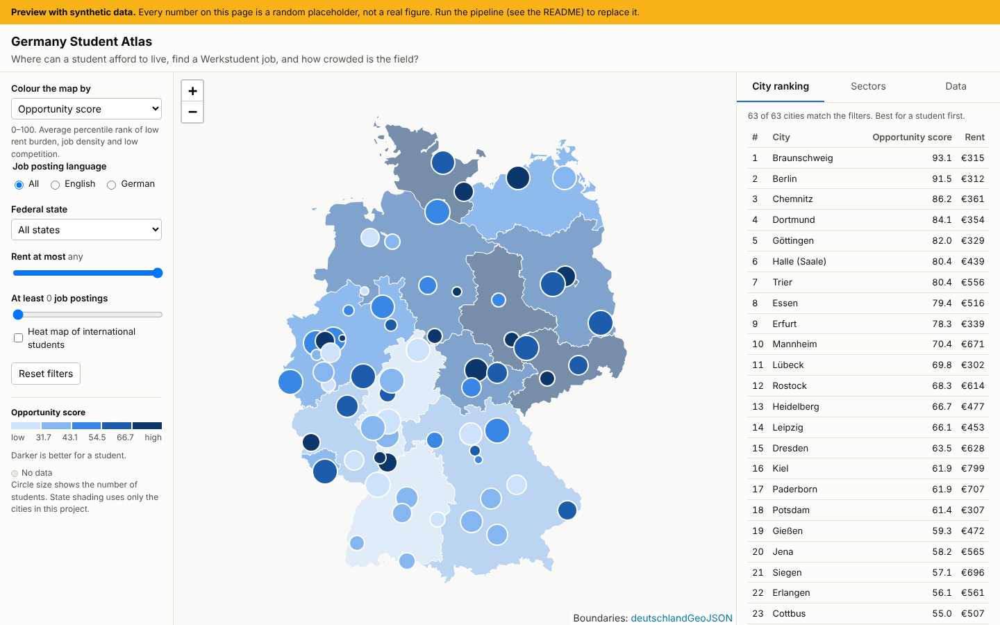

# Germany Student Atlas

An interactive map of German university cities for a student deciding where to
live and work: what a room costs, how many working-student (Werkstudent) jobs
are advertised in English and in German, how many international students
compete for them, and which occupational fields are hiring or shrinking.



**Live map:** `https://mohamad-nasher.github.io/germany-student-atlas/`

> **Status of the data in this repository.** The files in `docs/data/` are
> currently **synthetic placeholders** produced by `atlas sample` so the map can
> be previewed; the map shows a banner saying so. The first run of the pipeline
> replaces them. The live fetchers are covered by tests against recorded
> example responses but had not yet been run against the real services when
> this was written, so expect to fix small things on the first run.

## What the map shows

| Measure | Definition |
|---|---|
| Monthly rent | Rent for a room in a shared flat (or €/m² × 20 m² when only that is known) |
| Rent as share of student income | Rent ÷ gross pay of a 20 h/week minimum-wage job (€13.90/h in 2026 → about €1,204/month) |
| Werkstudent postings | Open postings near the city on the federal job board, split into English and German by posting title |
| Postings per 1,000 students | Postings ÷ enrolled students |
| International students | Students with a foreign nationality, and their share of all students |
| Intl. students per English posting | The competition measure: international students ÷ (English postings + 1) |
| Opportunity score | 0–100; mean percentile rank of low rent burden, high job density and low competition |

The 16 federal states are shaded by the same measure, aggregated over the 63
cities in `config/cities.csv` (so a state value describes its university cities,
not the whole state). The **Sectors** tab groups occupational fields into
labour shortage, growing, stable and shrinking.

## Quick start

```bash
git clone https://github.com/Mohamad-Nasher/germany-student-atlas.git
cd germany-student-atlas
python -m venv .venv && source .venv/bin/activate
pip install -e ".[dev]"

pytest -q            # 35 tests, no network needed
atlas build          # fetch jobs and sectors, merge data/manual, write docs/data
atlas analyze        # regressions -> analysis/results.md
make serve           # open http://localhost:8000
```

`atlas build` takes roughly ten minutes: it makes several hundred requests and
deliberately waits 1.5 s between them.

To put real rents and student numbers on the map, fill in the three CSV files
in `data/manual/` (formats and official sources are in `data/manual/README.md`).
Until you do, those measures show as "no data" rather than a guess.

## Publishing on GitHub

1. Push the repository, then **Settings → Pages → Deploy from a branch →
   `main` / `/docs`**.
2. **Actions → Refresh data → Run workflow** for the first real data pull. It
   then runs every Monday, commits the new `docs/data/`, and builds up the
   sector history in `data/history/sectors.csv` that the trend labels need.
3. Replace `Mohamad-Nasher` in this file and in `config/settings.yaml` (the
   User-Agent tells the data providers who is calling).

## How it works

```
config/            cities, sectors, every assumption (wage, hours, search radius)
data/manual/       rents, students, official shortage scores (you maintain these)
src/atlas/
  http.py          rate-limited, identifiable HTTP client with robots.txt check
  jobs_ba.py       federal job board: Werkstudent postings per city
  jobs_arbeitnow.py  second job board with a public API, English-heavy
  language.py      English/German classifier for posting text
  sectors.py       open postings per occupational field, history, labels
  listings.py      generic listing scraper (no sources configured by default)
  affordability.py indicators and the opportunity score
  build.py         runs everything, writes docs/data/*.json with provenance
  analysis.py      OLS regressions with robust standard errors
docs/              the static map (Leaflet, no build step) served by GitHub Pages
tests/             unit and end-to-end tests on recorded responses
```

Every output file carries provenance: `docs/data/meta.json` records, per layer,
whether it was fetched, taken from official figures you entered, missing, or
failed, and the map's **Data** tab displays it.

## Methods and limits

- **Language split.** The job board returns postings in pages, so the split is
  measured on up to 300 postings per search term per city and scaled to the
  reported total. Classification uses the title only, with a transparent word
  list (`language.py`); an English title does not guarantee an English workplace.
- **Job counts are postings, not vacancies**, and employers are not required to
  list with the federal agency. English-language start-up roles are
  under-represented there, which is why a second board is added.
- **Sector labels.** "Growing" and "shrinking" compare open postings with a
  snapshot at least three weeks older (±10 %). Before two snapshots exist, the
  share of postings published in the last 30 days stands in. Falling postings
  mean weaker hiring; they are **not** a count of layoffs. "Labour shortage"
  needs the federal agency's shortage score in `data/manual/sector_official.csv`.
- **Rents.** No large German rental portal permits scraping, so the default is
  published figures; see `docs/DATA_SOURCES.md` for the reasoning and for how to
  add a listing source that allows automated access.
- **Regressions** (`atlas analyze`): log rent and log job density on city size,
  international share and an east/west dummy, OLS with HC3 standard errors.
  With about 60 cities and one cross-section these are descriptive
  associations. Natural extensions: a city panel from the weekly snapshots with
  city fixed effects, spatial dependence between neighbouring cities, and an
  instrument for student inflows.

## Licence and credits

Code: MIT. State boundaries: [deutschlandGeoJSON](https://github.com/isellsoap/deutschlandGeoJSON).
Map library: [Leaflet](https://leafletjs.com) (BSD-2-Clause, bundled in `docs/vendor`).
Job data: Bundesagentur für Arbeit; Arbeitnow.
